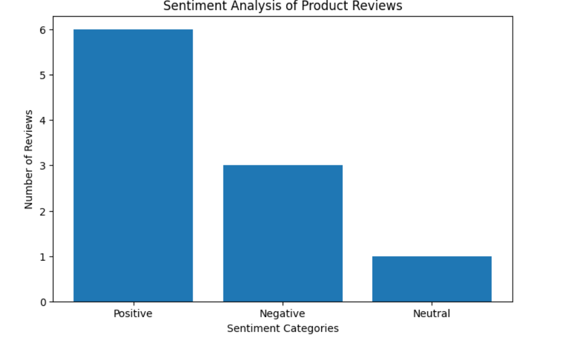

# Experiment 6 : Sentiment Analysis of Product Reviews Using TextBlob

## Aim
To load product review text, perform sentiment polarity analysis using the `TextBlob` library, classify reviews into **Positive**, **Negative**, or **Neutral** categories, and visualize the overall sentiment distribution using a Matplotlib bar chart.

## Algorithm

1. **Start** the program.
2. **Import Libraries**: Import `TextBlob` from the `textblob` package for Natural Language Processing (NLP) sentiment analysis and `matplotlib.pyplot` as `plt` for bar chart visualization.
3. **Create Review Dataset**: Define a Python list `reviews` containing 10 sample customer product review strings.
4. **Initialize Sentiment Counters**: Set `positive = 0`, `negative = 0`, and `neutral = 0` to track category counts.
5. **Analyze & Classify Each Review**:
   * Iterate through each `review` in `reviews`.
   * Create a `TextBlob(review)` object and extract `polarity = analysis.sentiment.polarity`.
   * Classify the review:
     * If $\text{polarity} > 0.1$, label as `"Positive"` and increment `positive`.
     * Else if $\text{polarity} < -0.1$, label as `"Negative"` and increment `negative`.
     * Else, label as `"Neutral"` and increment `neutral`.
   * Display the review text, rounded polarity score, and assigned sentiment label.
6. **Display Summary Counts**: Print the total count of Positive, Negative, and Neutral reviews.
7. **Visualize Sentiment Distribution**:
   * Plot a bar chart using `plt.bar()` with sentiment categories on the X-axis and review counts on the Y-axis.
   * Add a title, axis labels, and render the chart via `plt.show()`.
8. **Stop** the program.

## Functions and Methods Used

| Category | Function / Attribute | Purpose / Description |
| :--- | :--- | :--- |
| **Sentiment Analysis** | `TextBlob(text)` | Wraps a text string in a TextBlob NLP object for linguistic analysis |
| | `.sentiment.polarity` | Computes a floating-point sentiment polarity score in the range $[-1.0, +1.0]$ |
| **Formatting & Math** | `round(polarity, 2)` | Rounds raw polarity scores to 2 decimal places for clean console output |
| **Visualization (Matplotlib)** | `plt.figure()`, `plt.bar()` | Initializes a figure window and renders a color-coded vertical bar chart |
| | `plt.title()`, `plt.xlabel()`, `plt.ylabel()`, `plt.show()` | Configures chart title, axis labels, and displays the final visualization |

## Program
```python
#Step 1: Create a List of Sample Product Reviews

from textblob import TextBlob
import matplotlib.pyplot as plt

reviews = [
    "This product is excellent and very useful.",
    "I am extremely happy with the quality.",
    "The delivery was fast and the product is amazing.",
    "Good value for money and great performance.",
    "I love this product and recommend it.",
    "The product is very bad and disappointing.",
    "Poor quality and terrible customer service.",
    "I am unhappy with this product.",
    "The product is okay and works as expected.",
    "Average quality with normal performance."
]

#Step 2: Initialize Sentiment Counters

positive = 0
negative = 0
neutral = 0

#Step 3: Analyze Sentiment for Each Review

print("----- SENTIMENT ANALYSIS OF PRODUCT REVIEWS -----")

for review in reviews:
    analysis = TextBlob(review)
    polarity = analysis.sentiment.polarity

    if polarity > 0.1:
        sentiment = "Positive"
        positive += 1

    elif polarity < -0.1:
        sentiment = "Negative"
        negative += 1

    else:
        sentiment = "Neutral"
        neutral += 1

    print("\nReview:", review)
    print("Polarity Score:", round(polarity, 2))
    print("Sentiment:", sentiment)

#Step 4: Display Summary

print("\n----- SENTIMENT SUMMARY -----")

print("Positive Reviews:", positive)
print("Negative Reviews:", negative)
print("Neutral Reviews:", neutral)

#Step 5: Plot Sentiment Distribution


plt.figure(figsize=(8, 5))

plt.bar(categories, counts, color="#1f77b4")

plt.title("Sentiment Analysis of Product Reviews")
plt.xlabel("Sentiment Categories")
plt.ylabel("Number of Reviews")

plt.show()
```

## Output
```text
 ----- SENTIMENT ANALYSIS OF PRODUCT REVIEWS -----

Review: This product is excellent and very useful.
Polarity Score: 0.7
Sentiment: Positive

Review: I am extremely happy with the quality.
Polarity Score: 0.8
Sentiment: Positive

Review: The delivery was fast and the product is amazing.
Polarity Score: 0.4
Sentiment: Positive

Review: Good value for money and great performance.
Polarity Score: 0.75
Sentiment: Positive

Review: I love this product and recommend it.
Polarity Score: 0.5
Sentiment: Positive

Review: The product is very bad and disappointing.
Polarity Score: -0.75
Sentiment: Negative

Review: Poor quality and terrible customer service.
Polarity Score: -0.7
Sentiment: Negative

Review: I am unhappy with this product.
Polarity Score: -0.6
Sentiment: Negative

Review: The product is okay and works as expected.
Polarity Score: 0.2
Sentiment: Positive

Review: Average quality with normal performance.
Polarity Score: 0.0
Sentiment: Neutral

----- SENTIMENT SUMMARY -----
Positive Reviews: 6
Negative Reviews: 3
Neutral Reviews: 1
```


## Result
The program successfully loads a list of sample product reviews, applies `TextBlob` sentiment polarity scoring to classify each review's emotional tone, prints summary counts, and visualizes the overall distribution with a Matplotlib bar chart.

